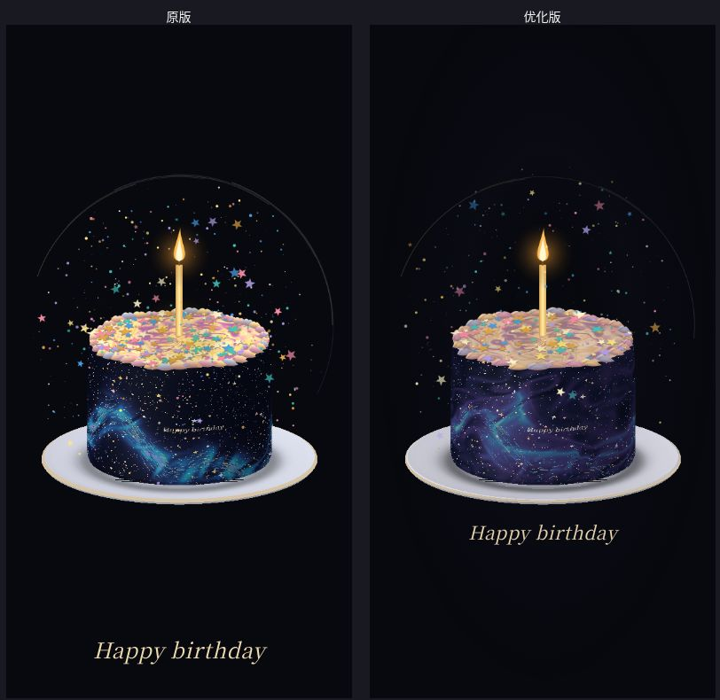

# 星空蛋糕视觉复盘

基线 deef77f。Blender 模型提供 160 段旋转体、轻微轮廓起伏和有厚度的瓷盘。Three.js 组装挤花、糖片和真实点光源。贴图由 Python 离线生成。

第一轮调整了星河色带、奶油脊线阴影、糖星密度、釉面粗糙度和接触阴影。第二轮将微尘分三层、改用顶点着色器漂浮，收拢竖屏题字。动态分辨率只在持续慢帧后逐级下降。兼容模式预计算采样位置并复用装饰对象。

云端 Chrome，390×760 CSS 像素，Canvas 软件路径，逐版连续采样 100 帧。JS 绘制回调中位数 13.1 → 7.1 ms，P95 18.6 → 9.8 ms。窗口平均 RAF 38.3 → 35.2 FPS；回调耗时下降，整体 FPS 未见改善。根据 Three.js 场景图统计，绘制对象 22 → 18，网格三角面 65,670 → 38,110，不含线和点。尚无真实 iPhone Safari 帧率、峰值内存及 WebGL GPU 耗时测量。